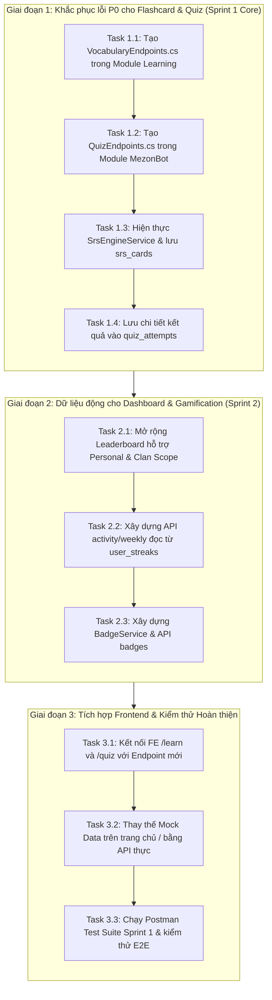

# 📋 KẾ HOẠCH TRIỂN KHAI API BACKEND CHO GIAO DIỆN FRONTEND
## DỰ ÁN LINGUAL — NỀN TẢNG HỌC NGOẠI NGỮ CỘNG ĐỒNG TRÊN MEZON
### PHẠM VI NGHIỆP VỤ: SPRINT 0, SPRINT 1 VÀ SPRINT 2

> **Đơn vị thực hiện:** Team 05 — Đụt Cận Trĩ (Mezon Campus Studio 2026)  
> **Thành viên:** Ngô Văn Công (Lead/AI), Nguyễn Công Minh (Backend/DB), Phan Phước Trí (Frontend/QA)  
> **Bộ công nghệ:** Backend ASP.NET Core 8 (Modular Monolith) + Frontend Next.js 14 (App Router) + PostgreSQL 16 + Redis 7  
> **Trạng thái tài liệu:** v1.0 — Kế hoạch thực thi chi tiết từ Sprint 2 trở về trước (Sprint 0, Sprint 1, Sprint 2)  
> **Mục tiêu:** Mở thông 100% kết nối giữa giao diện Web App hiện có (`src/web-app`) và CSDL PostgreSQL/Redis, xử lý triệt để lỗi HTTP 503 và thay thế toàn bộ dữ liệu mock bằng dữ liệu động.

---

## 📌 1. TỔNG QUAN HIỆN TRẠNG & ĐIỂM NGHẼN (GAP ANALYSIS)

### 1.1 Giao diện Frontend hiện có (`src/web-app`)
1. **Trang Học từ vựng Flashcard 3D (`/learn` — `FlashcardStudy.tsx`):**
   - Lật thẻ 3D hai mặt hiển thị từ vựng Oxford/CEFR A1–A2, phát âm IPA, nút nghe audio (Web Speech API), nghĩa tiếng Việt, ví dụ song ngữ.
   - 4 nút đánh giá theo thuật toán lặp lại ngắt quãng **SM-2**: *Again (1), Hard (2), Good (4), Easy (5)* kèm nhãn thời gian dự tính (`< 10 phút`, `1 ngày`, `3 ngày`, `6 ngày`).
   - Tích lũy điểm XP trong phiên và popup nhận thưởng.
2. **Trang Luyện tập Trắc nghiệm (`/quiz` — `quiz/page.tsx`):**
   - 3 chế độ luyện tập: `sprint10` (10 câu), `clan20` (20 câu), `marathon` (300 câu).
   - Đếm ngược 30 giây/câu, combo streak thưởng XP, giải thích đáp án chi tiết và danh sách câu sai.
3. **Trang Tổng quan / BXH & Tiến độ (`/` — `src/web-app/src/app/page.tsx`):**
   - Chuyển đổi tab: BXH Cá nhân (`personal`) & BXH Đội nhóm (`clan`).
   - Lọc thời gian: Tuần này (`weekly`), Tháng này (`monthly`), Mọi thời đại (`alltime`).
   - Thẻ tiến độ người học: Rank, Level, XP, Chuỗi ngày Streak.
   - Biểu đồ tiến độ 7 ngày trong tuần (**Weekly Progress**: T2 ➔ CN).
   - Bộ sưu tập Huy hiệu (**Badges Collection**: Streak, Vocabulary, Speed, Social).
4. **Trang Xác thực Mezon OAuth 2.0 SSO (`/auth`, `/auth/*`, `/oauth/mezon/callback`):**
   - Đăng nhập một chạm Mezon SSO, cấp JWT Bearer Token, làm mới token, thu hồi phiên làm việc (Blacklist JTI).

### 1.2 Điểm nghẽn kỹ thuật hiện tại trên Backend
* ❌ **Lỗi HTTP 503 tại `/api/vocabulary`:** Trang `/learn` không tải được từ vựng từ PostgreSQL do controller cũ bị gỡ bỏ khi refactor; backend chưa có endpoint tương ứng trong module `Lingual.Modules.Learning`.
* ❌ **Lỗi HTTP 503 tại `/api/quizzes`:** Trang `/quiz` không tải được ngân hàng 300 câu hỏi trắc nghiệm do backend chưa có endpoint trong module `Lingual.Modules.MezonBot`.
* 🟡 **Lưu kết quả Flashcard Review chưa chuẩn nghiệp vụ:** Endpoint `POST /api/v1/content/reviews` hiện mới cộng điểm XP tạm thời trong module Gamification, **chưa tính toán thuật toán SM-2 và chưa cập nhật bảng `srs_cards`** trong `LearningDbContext`.
* 🟡 **Lưu kết quả Quiz Attempt chưa chuẩn nghiệp vụ:** Endpoint `POST /api/v1/content/quiz-attempts` hiện mới cộng XP tạm thời, **chưa lưu bài làm chi tiết (`answers_detail` JSONB)** vào bảng `quiz_attempts` trong `MezonBotDbContext`.
* 🟡 **Dữ liệu tĩnh trên Dashboard:** Biểu đồ tuần và danh sách huy hiệu trên trang `/` đang dùng mock data tĩnh (`WEEKLY_PROGRESS_DATA`, `BADGES_DATA`); bảng xếp hạng chưa phân tách rõ scope Cá nhân vs Clan.

---

## 🗂️ 2. MA TRẬN DANH MỤC API CẦN TRIỂN KHAI VÀ VỊ TRÍ THƯ MỤC CODE

Dưới đây là bảng tổng hợp toàn bộ các API trong phạm vi từ **Sprint 2 trở về trước**, đi kèm vị trí đường dẫn file mã nguồn cụ thể trong dự án:

| STT | Endpoint URL | Method | Module Backend phụ trách | Vị trí thư mục & Tên file mã nguồn chuẩn Vertical Slice | Màn hình FE tương ứng | Trạng thái |
| :---: | :--- | :---: | :--- | :--- | :--- | :---: |
| **01** | `/api/v1/content/vocabulary`<br>*(Alias: `/api/v1/learning/vocabulary`)* | `GET` | `Lingual.Modules.Learning` | `src/backend/Lingual.Modules.Learning/Features/Vocabulary/GetVocabulary/`<br>• `GetVocabularyQuery.cs`<br>• `GetVocabularyQueryHandler.cs`<br>• `GetVocabularyQueryValidator.cs`<br>• `GetVocabularyEndpoint.cs` | Trang Học Flashcard (`/learn`) | **Đã hoàn thành (VSA)** |
| **02** | `/api/v1/content/quizzes`<br>*(Alias: `/api/v1/quizzes`)* | `GET` | `Lingual.Modules.MezonBot` | `src/backend/Lingual.Modules.MezonBot/Features/Quiz/GetQuizzes/`<br>• `GetQuizzesQuery.cs`<br>• `GetQuizzesQueryHandler.cs`<br>• `GetQuizzesQueryValidator.cs`<br>• `GetQuizzesEndpoint.cs` | Trang Luyện tập Quiz (`/quiz`) | **Đã hoàn thành (VSA)** |
| **03** | `/api/v1/content/reviews`<br>*(Hoàn thiện SM-2 Persistence)* | `POST` | `Lingual.Modules.Learning` | `src/backend/Lingual.Modules.Learning/Features/Srs/SubmitReview/`<br>• `SubmitReviewCommand.cs`<br>• `SubmitReviewCommandHandler.cs`<br>• `SubmitReviewCommandValidator.cs`<br>• `SubmitReviewEndpoint.cs` | Trang Học Flashcard (`/learn`) | **Đã hoàn thành (VSA)** |
| **04** | `/api/v1/content/quiz-attempts`<br>*(Hoàn thiện Attempt Persistence)* | `POST` | `Lingual.Modules.MezonBot` | `src/backend/Lingual.Modules.MezonBot/Features/Quiz/SubmitQuizAttempt/`<br>• `SubmitQuizAttemptCommand.cs`<br>• `SubmitQuizAttemptCommandHandler.cs`<br>• `SubmitQuizAttemptCommandValidator.cs`<br>• `SubmitQuizAttemptEndpoint.cs` | Trang Luyện tập Quiz (`/quiz`) | **Đã hoàn thành (VSA)** |
| **05** | `/api/v1/gamification/leaderboard`<br>*(Mở rộng scope Personal & Clan)* | `GET` | `Lingual.Modules.Gamification` | `src/backend/Lingual.Modules.Gamification/Endpoints/GamificationEndpoints.cs`<br>Service: `.../Services/LeaderboardService.cs` | Trang Tổng quan / BXH (`/`) | **Sẵn sàng** |
| **06** | `/api/v1/gamification/activity/weekly` | `GET` | `Lingual.Modules.Gamification` | `src/backend/Lingual.Modules.Gamification/Features/Activity/GetWeeklyActivity/`<br>• `GetWeeklyActivityQuery.cs`<br>• `GetWeeklyActivityQueryHandler.cs`<br>• `GetWeeklyActivityEndpoint.cs` | Biểu đồ tiến độ tuần (`/`) | **Đã hoàn thành (VSA)** |
| **07** | `/api/v1/gamification/badges` | `GET` | `Lingual.Modules.Gamification` | `src/backend/Lingual.Modules.Gamification/Features/Badges/GetBadges/`<br>• `GetBadgesQuery.cs`<br>• `GetBadgesQueryHandler.cs`<br>• `GetBadgesEndpoint.cs` | Bộ sưu tập Huy hiệu (`/`) | **Đã hoàn thành (VSA)** |
| **08** | `/api/v1/gamification/streak/me` | `GET` | `Lingual.Modules.Gamification` | `src/backend/Lingual.Modules.Gamification/Endpoints/GamificationEndpoints.cs` | Thẻ Streak trên Dashboard (`/`) | **Sẵn sàng** |
| **09** | `/api/v1/learning/srs/due` | `GET` | `Lingual.Modules.Learning` | `src/backend/Lingual.Modules.Learning/Features/Srs/GetDueCards/`<br>• `GetDueCardsQuery.cs`<br>• `GetDueCardsQueryHandler.cs`<br>• `GetDueCardsEndpoint.cs` | Hàng đợi ôn tập Flashcard (`/learn`) | **Đã hoàn thành (VSA)** |
| **10** | `/api/v1/auth/mezon/authorize` | `GET` | `Lingual.Modules.Identity` | `src/backend/Lingual.Modules.Identity/Features/Auth/LoginWithMezon/LoginWithMezonEndpoint.cs` | Trang Đăng nhập Mezon (`/auth`) | **Sẵn sàng (VSA)** |
| **11** | `/api/v1/auth/mezon` | `POST` | `Lingual.Modules.Identity` | `src/backend/Lingual.Modules.Identity/Features/Auth/LoginWithMezon/LoginWithMezonEndpoint.cs` | Trang Callback SSO (`/oauth/mezon/callback`) | **Sẵn sàng (VSA)** |
| **12** | `/api/v1/auth/me` | `GET` | `Lingual.Modules.Identity` | `src/backend/Lingual.Modules.Identity/Features/Auth/LoginWithMezon/LoginWithMezonEndpoint.cs` | Khôi phục phiên làm việc (`auth-context.ts`) | **Sẵn sàng (VSA)** |
| **13** | `/api/v1/ai/grammar-check` | `POST` | `Lingual.Modules.AITutor` | `src/backend/Lingual.Modules.AITutor/Controllers/AITutorController.cs` | Kiểm tra ngữ pháp v0.1 | **Sẵn sàng** |
| **14** | `/api/v1/ai/scenarios` | `GET` | `Lingual.Modules.AITutor` | `src/backend/Lingual.Modules.AITutor/Controllers/AITutorController.cs` | Kịch bản đóng vai LingLing v1.0 | **P2 (Medium)** |

---

## 🛠️ 3. ĐẶC TẢ CHI TIẾT CÁC API CẦN TRIỂN KHAI MỚI HOẶC HOÀN THIỆN

### 3.1 Nhóm API Flashcard & Học tập Từ vựng (`Lingual.Modules.Learning`)

#### API 01: Lấy danh sách từ vựng chuẩn CEFR
* **Đường dẫn:** `GET /api/v1/content/vocabulary` (hỗ trợ thêm route alias: `GET /api/v1/learning/vocabulary`)
* **File triển khai:** `src/backend/Lingual.Modules.Learning/Endpoints/VocabularyEndpoints.cs`
* **DTO:** `src/backend/Lingual.Modules.Learning.Contracts/DTOs/VocabularyDto.cs`
* **Tham số Request:**
  * `limit` (Query int): Giới hạn số lượng bản ghi trả về, kẹp `Math.Clamp(limit, 1, 500)`, mặc định `50`.
  * `source_language` (Query string): Mặc định `"en"`.
  * `target_language` (Query string): Mặc định `"vi"`.
  * `level` (Query string, optional): Bộ lọc trình độ (`"A1"`, `"A2"`).
* **Nghiệp vụ Backend:**
  * Truy vấn bảng `vocabulary_items` thông qua `LearningDbContext`.
  * Điều kiện: `status = 'published'`, sắp xếp `ORDER BY normalized_term`.
  * Deserialize cột JSONB `examples` thành mảng C# object `List<VocabularyExampleDto>`.
* **Output Payload (200 OK):**
  ```json
  {
    "total": 50,
    "words": [
      {
        "id": "3fa85f64-5717-4562-b3fc-2c963f66afa6",
        "term": "ability",
        "normalized_term": "ability",
        "source_language": "en",
        "target_language": "vi",
        "ipa": "/əˈbɪləti/",
        "part_of_speech": "noun",
        "meaning": "khả năng, năng lực",
        "pronunciation_audio_url": null,
        "image_url": null,
        "examples": [
          {
            "source_text": "She has the ability to speak four languages.",
            "target_text": "Cô ấy có khả năng nói bốn thứ tiếng."
          }
        ]
      }
    ]
  }
  ```

#### API 03: Ghi nhận ôn tập từ vựng & Thuật toán SM-2 (SRS Review)
* **Đường dẫn:** `POST /api/v1/content/reviews` (Alias: `POST /api/v1/learning/srs/review`)
* **File triển khai:** 
  * Endpoint: `src/backend/Lingual.Modules.Learning/Endpoints/SrsEndpoints.cs`
  * Thuật toán SM-2: `src/backend/Lingual.Modules.Learning/Services/SrsEngineService.cs`
* **Input Body:**
  ```json
  {
    "vocabularyId": "3fa85f64-5717-4562-b3fc-2c963f66afa6",
    "rating": "good",
    "quality": 4,
    "repetitions": 1,
    "intervalDays": 6.0,
    "easeFactor": 2.50,
    "nextDueAt": "2026-11-20T07:44:12Z",
    "timeSpentMs": 3500,
    "idempotencyKey": "rev-user1-vocab1-1731567890"
  }
  ```
* **Nghiệp vụ Backend:**
  1. Kiểm tra tính hợp lệ dữ liệu đầu vào (`quality` 0–5, `easeFactor` $\ge 1.30$, `vocabularyId` tồn tại).
  2. Xác định `userId`: Lấy từ JWT Claims (`sub`/`NameIdentifier`), nếu không có token (khách thử nghiệm) thì fallback `demoUserId = Guid.Parse("00000000-0000-0000-0000-000000000001")`.
  3. Upsert vào bảng `srs_cards` cho cặp `(user_id, vocabulary_id)`:
     - Nếu chưa có: `INSERT INTO srs_cards (user_id, vocabulary_id, repetitions, interval_days, ease_factor, next_due_at, review_history) ...`
     - Nếu đã có: Cập nhật `repetitions`, `interval_days`, `ease_factor`, `next_due_at`, `lapses` (nếu quality < 3 thì tăng 1), và append bản ghi đánh giá vào cột `review_history` (JSONB).
  4. Cộng điểm XP qua `IGamificationService.AwardXpAsync` với `idempotencyKey`:
     - Thẻ mới học lần đầu: `+5 XP`.
     - Ôn tập thành công (quality $\ge 3$): `+3 XP`.
* **Output Payload (200 OK):**
  ```json
  {
    "saved": true,
    "xp": 3,
    "nextDueAt": "2026-11-20T07:44:12Z"
  }
  ```

#### API 09: Lấy hàng đợi thẻ nhớ đến hạn ôn tập (SRS Due Cards)
* **Đường dẫn:** `GET /api/v1/learning/srs/due`
* **File triển khai:** `src/backend/Lingual.Modules.Learning/Endpoints/SrsEndpoints.cs`
* **Nghiệp vụ:** Truy vấn các thẻ nhớ của người dùng hiện tại có `next_due_at <= DateTimeOffset.UtcNow` kèm thông tin từ vựng tương ứng từ `vocabulary_items`.

---

### 3.2 Nhóm API Ngân hàng Đề thi & Luyện tập Quiz (`Lingual.Modules.MezonBot`)

#### API 02: Lấy danh sách câu hỏi trắc nghiệm
* **Đường dẫn:** `GET /api/v1/content/quizzes` (Alias: `GET /api/v1/quizzes`)
* **File triển khai:** `src/backend/Lingual.Modules.MezonBot/Endpoints/QuizEndpoints.cs`
* **DTO:** `src/backend/Lingual.Modules.MezonBot.Contracts/DTOs/QuizQuestionDto.cs`
* **Tham số Request:**
  * `limit` (Query int): Giới hạn số câu hỏi theo mode (`sprint10` = 10, `clan20` = 20, `marathon` = 300; kẹp `Math.Clamp(limit, 1, 300)`).
  * `level` (Query string, optional): Cấp độ câu hỏi (`"A1"`, `"A2"`, `"B1"`, `"B2"`).
* **Nghiệp vụ Backend:**
  * Truy vấn bảng `quiz_questions` thông qua `MezonBotDbContext`.
  * Điều kiện: `status = 'published'` và `question_type = 'multiple_choice'`.
  * Đọc cột JSONB `options` để xác định key đáp án đúng (`is_correct = true` ➔ gán vào trường `correct_answer`).
* **Output Payload (200 OK):**
  ```json
  {
    "total": 10,
    "questions": [
      {
        "id": "8f14e45f-3c5b-4328-b998-8e67a9cf518a",
        "sort_order": 1,
        "level": "A1",
        "difficulty": 1,
        "question_type": "multiple_choice",
        "prompt": "She ____ to the library every Friday afternoon.",
        "options": [
          { "key": "A", "text": "goes", "is_correct": true },
          { "key": "B", "text": "go", "is_correct": false },
          { "key": "C", "text": "going", "is_correct": false },
          { "key": "D", "text": "gone", "is_correct": false }
        ],
        "correct_answer": "A",
        "explanation": "Chủ ngữ là ngôi thứ ba số ít 'She', thì hiện tại đơn đi với 'goes'.",
        "points": 10
      }
    ]
  }
  ```

#### API 04: Lưu trữ kết quả lượt làm bài Quiz (Quiz Attempt)
* **Đường dẫn:** `POST /api/v1/content/quiz-attempts` (Alias: `POST /api/v1/quizzes/attempts`)
* **File triển khai:** `src/backend/Lingual.Modules.MezonBot/Endpoints/QuizEndpoints.cs`
* **Input Body:**
  ```json
  {
    "idempotencyKey": "4c9441ec-bbfd-466a-b286-9b51fa12ce89",
    "xp": 130,
    "answers": [
      { "questionId": "8f14e45f-...", "selectedKey": "A", "isCorrect": true },
      { "questionId": "5a22c10b-...", "selectedKey": "C", "isCorrect": false }
    ]
  }
  ```
* **Nghiệp vụ Backend:**
  1. Tính toán `correct_count` (số câu `isCorrect = true`) và `max_score` (tổng số câu hỏi).
  2. Ghi bản ghi vào bảng `quiz_attempts`:
     - `status = 'submitted'`, `score = correct_count`, `submitted_at = now()`.
     - Cột `answers_detail` (JSONB) lưu toàn bộ mảng `answers` của học viên.
  3. Cộng điểm XP vào `xp_ledger` qua `IGamificationService.AwardXpAsync` (`source_type = 'clan_quiz'`), chống cộng trùng qua `idempotencyKey`.
  4. Nếu có cộng điểm XP thành công, tự động cập nhật điểm số tương ứng lên Redis Sorted Set `leaderboard:all-time`.
* **Output Payload (200 OK):**
  ```json
  {
    "saved": true,
    "correct_answers": 8,
    "xp": 130
  }
  ```

---

### 3.3 Nhóm API Gamification, Leaderboard & Tiến độ Dashboard (`Lingual.Modules.Gamification`)

#### API 05: Bảng xếp hạng Cá nhân & Bảng xếp hạng Clan (Leaderboard)
* **Đường dẫn:** `GET /api/v1/gamification/leaderboard` (và alias `/api/v1/content/leaderboard`)
* **File triển khai:** `src/backend/Lingual.Modules.Gamification/Endpoints/GamificationEndpoints.cs`
* **Service:** `src/backend/Lingual.Modules.Gamification/Services/LeaderboardService.cs`
* **Tham số Request:**
  * `scope` (Query string): `"personal"` (mặc định) hoặc `"clan"`.
  * `type` hoặc `timeRange` (Query string): `"weekly"`, `"monthly"`, `"all-time"` (mặc định `"all-time"`).
  * `limit` (Query int): Giới hạn số lượng (1..100, mặc định 20).
* **Nghiệp vụ Backend:**
  * Nếu `scope = "personal"`: Truy vấn Redis key `leaderboard:all-time` hoặc `leaderboard:weekly:{weekNumber}`. Trả về thông tin thành viên (rank, user_id, display_name, avatar, level, wordsLearned, xp, streakDays, isCurrentUser).
  * Nếu `scope = "clan"`: Truy vấn bảng `weekly_leaderboards` hoặc Redis key `leaderboard:clans:{weekNumber}`. Trả về thông tin Clan (rank, clan_id, clan_name, tag, wordsLearned, xp, memberCount).

#### API 06: Thống kê Tiến độ Học tập 7 ngày trong Tuần (Weekly Activity)
* **Đường dẫn:** `GET /api/v1/gamification/activity/weekly`
* **File triển khai:** `src/backend/Lingual.Modules.Gamification/Endpoints/GamificationEndpoints.cs`
* **Service:** `src/backend/Lingual.Modules.Gamification/Services/StreakService.cs`
* **Nghiệp vụ Backend:**
  * Lấy thông tin user hiện tại qua JWT Claims.
  * Truy vấn cột `daily_activity` (JSONB) từ bảng `user_streaks` và chi tiết các giao dịch trong `xp_ledger` từ Thứ Hai đến Chủ Nhật của tuần hiện tại (theo múi giờ `Asia/Ho_Chi_Minh`).
  * Trả về mảng 7 phần tử (T2, T3, T4, T5, T6, T7, CN) với các trường: `day`, `fullDay`, `date`, `words` (số từ đã học), `target` (mục tiêu ngày), `xpEarned` (XP tích lũy), `accuracy` (tỷ lệ trả lời đúng %), `isToday` (boolean).

#### API 07: Danh sách Huy hiệu & Tiến độ mở khóa (Badges)
* **Đường dẫn:** `GET /api/v1/gamification/badges`
* **File triển khai:** `src/backend/Lingual.Modules.Gamification/Endpoints/GamificationEndpoints.cs`
* **Service:** `src/backend/Lingual.Modules.Gamification/Services/BadgeService.cs` (tạo mới)
* **Nghiệp vụ Backend:**
  * Trả về danh mục 6 huy hiệu cốt lõi của Sprint 2:
    1. *Kỷ Lục Gia Streak (`streak`)*: Tiến độ dựa trên `user_streaks.current_streak` / 14 ngày.
    2. *Kho Báu Từ Vựng (`vocabulary`)*: Tiến độ dựa trên số lượng từ trong `srs_cards` / 200 từ.
    3. *Bất Khả Chiến Bại (`speed`)*: Đạt 100% điểm trong 5 bài Quiz liên tiếp trong `quiz_attempts`.
    4. *Chiến Hữu Mezon (`social`)*: Đóng góp 5,000 XP cho Clan.
    5. *Đại Sứ Học Thuật (`vocabulary`)*: Hoàn thành 500 từ vựng.
    6. *Đấu Vương Thời Gian Thực (`speed`)*: Hoàn thành thử thách tốc độ.
  * Mỗi huy hiệu trả về: `id`, `name`, `category`, `rarity`, `icon`, `description`, `unlocked`, `unlockedDate`, `progress`, `maxProgress`, `xpReward`, `lore`.

---

## 📅 4. KẾ HOẠCH TRIỂN KHAI THEO GIAI ĐOẠN (IMPLEMENTATION PLAN)



### 4.1 Chi tiết các bước thực hiện & Phân công trách nhiệm

| Giai đoạn | Mã Task | Nội dung công việc | File mã nguồn cần tạo / chỉnh sửa | Người phụ trách | Thời lượng | Tiêu chí nghiệm thu (DoD) |
| :--- | :---: | :--- | :--- | :---: | :---: | :--- |
| **Giai đoạn 1**<br>*(Sprint 1 P0)* | **T1.1** | Tạo Endpoint lấy danh sách từ vựng | `src/backend/Lingual.Modules.Learning/Endpoints/VocabularyEndpoints.cs` | Minh (BE) | 0.5 ngày | Trả về 50 từ vựng published, kẹp limit 1..500, test GET thành công HTTP 200. |
| | **T1.2** | Tạo Endpoint lấy câu hỏi trắc nghiệm | `src/backend/Lingual.Modules.MezonBot/Endpoints/QuizEndpoints.cs` | Minh (BE) | 0.5 ngày | Trả về câu hỏi đúng mode 10/20 câu, bóc đúng key đáp án từ JSONB `options`. |
| | **T1.3** | Thuật toán SM-2 & Lưu thẻ nhớ SRS | `src/backend/Lingual.Modules.Learning/Services/SrsEngineService.cs`<br>`src/backend/Lingual.Modules.Learning/Endpoints/SrsEndpoints.cs` | Minh (BE) | 1.0 ngày | Gọi review cập nhật đúng `interval_days`, `ease_factor`, `next_due_at` và cộng XP vào `xp_ledger`. |
| | **T1.4** | Lưu phiên làm bài Quiz | `src/backend/Lingual.Modules.MezonBot/Endpoints/QuizEndpoints.cs` | Minh (BE) | 0.5 ngày | Ghi nhận bản ghi `quiz_attempts` kèm `answers_detail` JSONB, tăng điểm Leaderboard Redis. |
| **Giai đoạn 2**<br>*(Sprint 2)* | **T2.1** | Nâng cấp Leaderboard Redis | `src/backend/Lingual.Modules.Gamification/Endpoints/GamificationEndpoints.cs`<br>`src/backend/Lingual.Modules.Gamification/Services/LeaderboardService.cs` | Minh (BE) | 0.5 ngày | Lọc được tab Cá nhân / Clan, hỗ trợ weekly và all-time, trả về rank của current user. |
| | **T2.2** | Triển khai API Weekly Activity | `src/backend/Lingual.Modules.Gamification/Endpoints/GamificationEndpoints.cs`<br>`src/backend/Lingual.Modules.Gamification/Services/StreakService.cs` | Minh (BE) | 0.5 ngày | Trả về đúng mảng 7 ngày tiến độ từ `daily_activity` và `xp_ledger` theo múi giờ VN. |
| | **T2.3** | Triển khai API Badges | `src/backend/Lingual.Modules.Gamification/Services/BadgeService.cs`<br>`src/backend/Lingual.Modules.Gamification/Endpoints/GamificationEndpoints.cs` | Minh (BE) | 0.5 ngày | Trả về danh sách 6 huy hiệu với tiến độ tính toán từ CSDL thực tế. |
| **Giai đoạn 3**<br>*(Frontend & QA)* | **T3.1** | Tích hợp & Kiểm thử Flashcard và Quiz | `src/web-app/src/app/learn/page.tsx`<br>`src/web-app/src/app/quiz/page.tsx`<br>`src/web-app/src/components/FlashcardStudy.tsx` | Trí (FE/QA) | 0.5 ngày | **Đã hoàn thành**: FE `/learn` lật thẻ và đánh giá 4 nút mượt mà; FE `/quiz` gọi ngân hàng câu hỏi và nộp bài nộp không lỗi 503. |
| | **T3.2** | Kết nối dữ liệu động trang Dashboard | `src/web-app/src/app/page.tsx`<br>`src/web-app/src/app/api/activity/weekly/route.ts`<br>`src/web-app/src/app/api/badges/route.ts` | Trí (FE/QA) | 0.5 ngày | **Đã hoàn thành**: Thay thế toàn bộ mock data tĩnh, biểu đồ tuần và huy hiệu hiển thị từ API backend. |
| | **T3.3** | Chạy kiểm thử tự động Postman | `docs/postman/Lingual_Sprint1_Postman_Collection.json` | Trí (QA) | 0.5 ngày | Sẵn sàng chạy kiểm thử toàn bộ test suite Sprint 1 khi khởi động Docker/Local. |

---

## ⚠️ 5. QUY TẮC BẢO MẬT & ĐỒNG THỜI CẦN TUÂN THỦ (CONCURRENCY GUIDELINES)

Căn cứ theo tài liệu [docs/database/sql/README.md](file:///c:/Minh/NCCPLUS/mezon-campus-studio-06-2026-ut-can-tri/docs/database/sql/README.md), đội ngũ cần tuyệt đối lưu ý các quy chuẩn sau khi viết code:

1. **Chống Lost Update trên mảng JSONB đa-writer:**  
   Tuyệt đối **không** dùng cơ chế read-modify-write qua EF Core change tracking (`entity.List.Add() ; SaveChanges()`) đối với các mảng JSONB như `srs_cards.review_history`, `quiz_attempts.answers_detail`, `user_streaks.freeze_history`. Phải thực thi câu lệnh SQL nguyên tử:
   ```sql
   UPDATE srs_cards
   SET review_history = review_history || @newReview::jsonb,
       updated_at = now()
   WHERE id = @cardId;
   ```
2. **Quy tắc Upsert chống Race Condition:**  
   Luôn sử dụng `INSERT ... ON CONFLICT (user_id, vocabulary_id) DO NOTHING` hoặc `ON CONFLICT (idempotency_key) DO NOTHING` cho `srs_cards` và `xp_ledger` để chống lỗi trùng lặp khi người dùng click nút liên tục.
3. **Múi giờ hoạt động chuẩn:**  
   Toàn bộ tính toán chuỗi ngày học Streak ($\ge 20$ XP/ngày) phải quy đổi theo múi giờ địa phương Việt Nam `Asia/Ho_Chi_Minh` (GMT+7) từ cột `TIMESTAMPTZ` của hệ thống.
