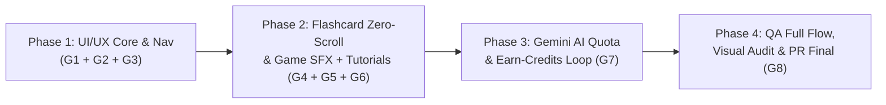

# KẾ HOẠCH TRIỂN KHAI NÂNG CẤP TUẦN 9 (FINAL POLISH — LINGUAL / MEZON CAMPUS STUDIO)

**Nguồn đầu vào đối soát:**
1. **Biên bản cuộc họp Demo Sprint 2 (21/11/2026)** cùng Mentor Mai Hồng Mận (`man.maihong`).
2. **Bản review UI/UX từ AI của Mentor** (`1795271828234.txt` — 5 hạng mục cụ thể kèm đường dẫn mã nguồn).

**Mục tiêu Tuần 9:** Nâng tầm trải nghiệm người dùng (UI/UX, Zero-Scroll Flashcard, Onboarding Tutorial, Game SFX), bổ sung vòng lặp Gamification kiểm soát chi phí **AI Chatbot Quota + Kiếm thêm lượt**, xử lý dứt điểm toàn bộ điểm trừ thẩm mỹ/Empty State và đóng gói sản phẩm đạt chuẩn nộp **Final**.

---

## 1. TỔNG HỢP MA TRẬN YÊU CẦU & PHÂN ĐỘ ƯU TIÊN

| Nhóm | Nguồn | Hạng mục nâng cấp | Mức độ | Phạm vi kỹ thuật |
| :--- | :--- | :--- | :---: | :--- |
| **G1** | Review #2 | Xóa `bg-slate-950 text-slate-100` ở `layout.tsx`, thay chữ Hán `語` ở Hero bằng biểu tượng tiếng Anh (`Aa` / `EN`), nâng độ tương phản màu sắc Hero & Accent Streak/XP | **P0** | Frontend (`layout.tsx`, `page.tsx`, `globals.css`) |
| **G2** | Review #1 + #3 | Khắc phục Empty State Trang chủ: thêm **Daily Goal Progress Bar**, thẻ **Word of the Day (có phát âm TTS)**, Empty State biểu đồ 7/30 ngày có CTA; thay card xám `Luyện nghe (dự kiến)` bằng 2 card nổi bật **LingLing AI** & **Arena 1vs1** (lưới 6 card 3x2) | **P0** | Frontend (`page.tsx`, `globals.css`) |
| **G3** | Review #4 | Thu gọn Thanh Navigation từ **8 tab xuống 6 tab chính** (gom `Flashcard` + `Từ vựng` thành `Học từ`, gom `Game Center` + `Arena 1vs1` thành `Đấu trường` có sub-tab chuyển nhanh bên trong) chống chật/tràn trên laptop 13–14 inch | **P0** | Frontend (`AppNavigation.tsx`, `learn/page.tsx`, `words/page.tsx`, `games/page.tsx`, `arena/page.tsx`, `globals.css`) |
| **G4** | Họp 21/11 + Review #5 | Tái thiết kế **Flashcard `/learn`** thành **Split 2-Column Cockpit trên Desktop** (Zero-Scroll): chuyển toàn bộ nút `Lật thẻ` + 4 nút đánh giá SM-2 + gợi ý phím tắt sang **cột bên phải**, thêm thanh chọn nhanh cấp độ CEFR / chủ đề và tiến độ phiên học phía trên | **P0** | Frontend (`learn/page.tsx`, `FlashcardStudy.tsx`, `globals.css`) |
| **G5** | Họp 21/11 | Xây dựng **Hệ thống Tutorial Pop-up Step-by-Step**: (1) Tour hướng dẫn người mới qua các tab chính của Web App; (2) Pop-up hướng dẫn luật chơi 3 bước cho từng mini-game trong 6 trò của Game Center; có nút `? Hướng dẫn` mở lại và hỗ trợ song ngữ VI/EN | **P1** | Frontend (`components/OnboardingTour.tsx`, `components/GameTutorialModal.tsx`, `layout.tsx`, `games/page.tsx`) |
| **G6** | Họp 21/11 | Bổ sung **Hiệu ứng Âm thanh (Web Audio SFX)** đúng/sai/lật thẻ/combo/đếm ngược/chiến thắng + nút bật/tắt âm thanh (Mute toggle) & hiệu ứng tương tác cho Game Center, Quiz và Flashcard | **P1** | Frontend (`lib/sound-effects.ts`, `games/page.tsx`, `quiz/page.tsx`, `FlashcardStudy.tsx`) |
| **G7** | Họp 21/11 | Xây dựng **Cơ chế Giới hạn Lượt Dùng AI Chatbot Gemini + Kiếm Thêm Lượt** qua chơi game / làm quiz / ôn flashcard (DB PostgreSQL + Backend Modular Monolith + Giao diện thanh lượt & CTA kiếm lượt trên `/tutor`) | **P1** | Full-stack (`Lingual.Modules.AITutor`, `Gamification`, `Learning`, `Program.cs --migrate`, `tutor/page.tsx`, `/api/ai/quota`) |
| **G8** | Họp 21/11 | Đóng gói vận hành Tuần 9: tách bot test local khỏi `@LingLing` prod, kiểm tra Redirect URI & CORS production Render, cập nhật link tĩnh trên Board, chạy full unit test + Playwright E2E + Visual QA trước khi tạo PR | **P1** | DevOps / QA / Runbook |

---

## 2. LỘ TRÌNH THỰC HIỆN CHI TIẾT (4 PHASE)

---

### PHASE 1: XỬ LÝ BUG GIAO DIỆN, TRANG CHỦ "KHÔNG TRỐNG" & THU GỌN NAVIGATION (G1, G2, G3)

#### 1.1 Sửa xung đột Dark Theme & Tăng điểm nhấn thị giác (G1)
- **[layout.tsx](src/web-app/src/app/layout.tsx#L36):**
  - Xóa `bg-slate-950 text-slate-100` khỏi `<body>`, thay bằng `min-h-full flex flex-col bg-[var(--paper)] text-[var(--ink)]` để triệt tiêu hoàn toàn viền đen khi tải trang hoặc khi trang ngắn.
- **[page.tsx](src/web-app/src/app/page.tsx#L87):**
  - Thay ký tự chữ Hán `語` trong `` bằng `Aa` (kèm badge nhỏ `EN · A1–C2` đồng nhất với ứng dụng học tiếng Anh).
- **[globals.css](src/web-app/src/app/globals.css):**
  - Nâng cấp `.dashboard-hero` với nền gradient giấy ấm nổi khối (`linear-gradient(135deg, #fffdf7 0%, #f5efe0 60%, #edf2e3 100%)`) và viền rõ ràng hơn.
  - Tô điểm rõ hệ thống màu Gamification: `.dashboard-streak` dùng accent cam đất / hổ phách (`#d97706` / `#b45309` trên nền `#fff7ed`), XP dùng tông hổ phách ấm, tách bạch trực quan giữa 4 phân khu: Hero, Stats, Community Leaderboard, Activities.

#### 1.2 Làm đầy trải nghiệm Trang chủ cho người dùng mới (G2)
- **[page.tsx](src/web-app/src/app/page.tsx):**
  1. **Mục tiêu hôm nay (Daily Goal Progress Bar):** Đặt ngay trong Hero (dưới nút CTA chính), hiển thị 2 thanh tiến độ thực tế:
     - `Từ đã ôn hôm nay`: `reviewedToday / 10 từ` (đọc từ `/api/reviews` + phiên quiz hôm nay).
     - `XP hôm nay`: `xpToday / 50 XP` (tính từ lịch sử hoạt động trong ngày).
  2. **Thẻ Từ vựng hôm nay (Word of the Day):**
     - Lấy ổn định 1 từ theo hạt giống ngày (`YYYY-MM-DD`) từ tập dữ liệu `/api/vocabulary?limit=100` (có nút `Đổi từ khác` để khám phá tiếp).
     - Hiển thị: Từ tiếng Anh, cấp độ CEFR (`A2`/`B1`...), phiên âm IPA, loại từ, nghĩa tiếng Việt, câu ví dụ ngữ cảnh, nút **Nghe phát âm** (`window.speechSynthesis`) và nút **Học ngay** -> `/learn`.
  3. **Empty State thông minh cho biểu đồ 7/30 ngày:**
     - Khi tổng từ học trong `7/30` ngày = `0`, hiển thị hộp dẫn dắt gọn gàng kèm nút **`Làm quiz đầu tiên để vẽ biểu đồ`** (`/quiz`) thay vì 7 cột phẳng trơ trống.
  4. **Lưới 6 hoạt động cân đối (3x2 trên Desktop, 2x3 trên Tablet, 1 cột trên Mobile):**
     - **Xóa** card xám `Luyện nghe — Tính năng dự kiến`.
     - **Bổ sung 2 card chính thức**:
       - **LingLing AI (`/tutor`)**: Hội thoại đóng vai tình huống & sửa ngữ pháp tức thì với Gemini AI.
       - **Đấu trường 1vs1 (`/arena`)**: Thách đấu phản xạ từ vựng tốc độ cao cùng bạn bè.
     - Toàn bộ 6 card (`Học từ mới`, `Ôn flashcard`, `Quiz nhanh`, `Game Center`, `LingLing AI`, `Đấu trường 1vs1`) có màu icon phân biệt rõ ràng và hỗ trợ song ngữ VI/EN 100%.

#### 1.3 Thu gọn Thanh Navigation trên cùng (G3)
- **[AppNavigation.tsx](src/web-app/src/components/AppNavigation.tsx):**
  - Giảm từ **8 tab xuống 6 tab chính** (cực thoáng trên màn hình laptop 1280px–1366px):
    1. `Tổng quan` / `Overview` (`/`)
    2. `Học từ` / `Vocabulary` (`/words` — active cho cả `/words` và `/learn`)
    3. `Luyện tập` / `Practice` (`/quiz`)
    4. `Đấu trường` / `Games & 1v1` (`/games` — active cho cả `/games` và `/arena`)
    5. `LingLing AI` (`/tutor`)
    6. `Giải đấu` / `Leaderboard` (`/leaderboard`)
  - Thêm nút nhỏ hình dấu `?` (`Hướng dẫn`) ngay cạnh nút `VI / EN` để mở lại Onboarding Tutorial bất cứ lúc nào.
  - Thêm **thanh chuyển Sub-tab nhanh** ngay đầu trang của 2 cặp route gộp:
    - Trong `/words` và `/learn`: `[Thư viện từ vựng | Ôn Flashcard SM-2]`
    - Trong `/games` và `/arena`: `[Game Center (6 mini-game) | Đấu trường 1vs1]`
    - Toàn bộ URL cũ (`/learn`, `/words`, `/games`, `/arena`) giữ nguyên hoạt động 100%, không gãy bất kỳ link nào.

---

### PHASE 2: FLASHCARD ZERO-SCROLL, TUTORIAL STEP-BY-STEP & GAME SFX (G4, G5, G6)

#### 2.1 Tái thiết kế Trang Flashcard `/learn` — Bố cục 2 cột Không Cuộn (G4)
- **[learn/page.tsx](src/web-app/src/app/learn/page.tsx) & [FlashcardStudy.tsx](src/web-app/src/components/FlashcardStudy.tsx):**
  - **Compact Top Control Bar:**
    - Thanh sub-tab chuyển nhanh `Thư viện từ vựng` / `Ôn Flashcard`.
    - Bộ lọc nhanh cấp độ CEFR (`Tất cả`, `A1`, `A2`, `B1`, `B2`, `C1`, `C2`) + tùy chọn số thẻ phiên (`10`, `20`, `50` thẻ) gọi trực tiếp `/api/vocabulary?limit=...&level=...`.
    - Thanh tiến độ gọn (`Thẻ 3 / 10` · `30%` · `+45 XP phiên này`) nằm cùng 1 hàng trên Desktop.
  - **Split 2-Column Cockpit (Desktop >= 1024px, khóa chiều cao vừa 1 khung nhìn không cần scroll):**
    - **Cột trái (62%):** Thẻ Flashcard 3D (`max-height` tối ưu ~`400px–440px`) hiển thị rõ từ vựng, IPA, loại từ, nút phát âm lớn ở mặt trước và nghĩa tiếng Việt + câu ví dụ in đậm từ khóa ở mặt sau.
    - **Cột phải (38%) — Bảng Điều Khiển & Đánh Giá SM-2:**
      - Nút lớn **`Lật thẻ / Xem đáp án`** (kèm badge phím `Space`).
      - Nút **`Nghe phát âm`** (kèm badge phím `R`).
      - Khối 4 nút đánh giá SM-2 xếp lưới `2x2` to, dễ bấm ngay ngang tầm mắt (không cần cuộn xuống dưới thẻ):
        - `1 · Lại (< 10 phút)` | `2 · Khó (1–3 ngày)`
        - `3 · Tốt (1–6 ngày)` | `4 · Rất dễ (+25 XP)`
      - Khung gợi ý phím tắt gọn (`Space`: Lật · `R`: Nghe · `1–4`: Chấm SM-2) + nút bật/tắt âm thanh lật thẻ.
  - **Mobile / Tablet (< 1024px):** Tự động chuyển mượt về 1 cột dọc như chuẩn mobile ergonomics.

#### 2.2 Hệ thống Hiệu ứng Âm thanh Web Audio SFX (G6)
- Tạo mới `src/web-app/src/lib/sound-effects.ts`:
  - Sử dụng `AudioContext` (Web Audio API thuần — **0 dependency ngoài, 0 file audio 404, phản hồi tức thì**), tự mở khóa audio theo thao tác click đầu tiên của trình duyệt.
  - Bộ 6 âm thanh chuẩn UI/Game:
    - `playCorrect()`: 2 nốt tăng tươi sáng (`C5 -> E5 -> G5`).
    - `playWrong()`: âm trầm êm ngắn (`220Hz -> 165Hz`, không gây chói tai).
    - `playFlip()`: tiếng lướt giấy mềm cho Flashcard.
    - `playClick()`: âm click nhẹ khi ghép từ / chọn thẻ.
    - `playTick()`: tiếng tích tắc nhẹ khi đồng hồ còn <= 5 giây.
    - `playVictory()`: đoạn fanfare ngắn khi hoàn thành game/quiz/flashcard.
  - Trạng thái bật/tắt lưu tại `localStorage` (`lingual_sfx_enabled`, mặc định bật), đồng bộ qua React hook `useSoundEffects()`.
- Tích hợp vào:
  - **[games/page.tsx](src/web-app/src/app/games/page.tsx):** Phát âm thanh ở tất cả 6 mini-game (đúng/sai, combo tăng cao độ, đếm ngược 5 giây cuối, hoàn thành trận), thêm nút `🔊 / 🔇` trên thanh trạng thái game.
  - **[quiz/page.tsx](src/web-app/src/app/quiz/page.tsx):** Âm thanh đúng/sai từng câu và hoàn thành bài quiz.
  - **[FlashcardStudy.tsx](src/web-app/src/components/FlashcardStudy.tsx):** Âm thanh lật thẻ nhẹ + âm thanh hoàn thành phiên học.

#### 2.3 Hệ thống Tutorial Pop-up Step-by-Step (G5)
1. **App Onboarding Tour (`src/web-app/src/components/OnboardingTour.tsx`):**
   - Gắn ở cấp layout toàn cục (`layout.tsx`), tự hiển thị 1 lần cho người mới (kiểm tra `localStorage.getItem("lingual_onboarding_v1_done")`) sau khi vào Trang chủ, hoặc mở lại bất cứ lúc nào khi bấm nút `?` trên `AppNavigation`.
   - Gồm **6 bước ngắn gọn** (có thanh tiến độ `1/6 .. 6/6`, icon minh họa trực quan, nút `Quay lại` / `Tiếp theo` / `Bỏ qua`, tự cuộn/highlight nhẹ mục tương ứng trên nav và song ngữ VI/EN):
     - Bước 1: Chào mừng đến LinguaMezon & Mục tiêu ngày / Từ vựng hôm nay.
     - Bước 2: **Học từ** (`/words`, `/learn`) — Kho 5.100 từ CEFR & Flashcard SRS SM-2.
     - Bước 3: **Luyện tập** (`/quiz`) — Củng cố vốn từ và vẽ biểu đồ tiến độ.
     - Bước 4: **Đấu trường** (`/games`, `/arena`) — 6 mini-game phản xạ & đấu 1vs1 kiếm XP + lượt AI.
     - Bước 5: **LingLing AI** (`/tutor`) — Đóng vai hội thoại & sửa ngữ pháp cùng Gemini AI.
     - Bước 6: **Giải đấu & Hồ sơ** (`/leaderboard`, `/profile`) — Đua top Clan và mở khóa 6 huy hiệu.
2. **Per-Game Tutorial Modal (`src/web-app/src/components/GameTutorialModal.tsx`):**
   - Tích hợp vào `games/page.tsx` cho đủ **6 mini-game** (`speed-match`, `sentence-scramble`, `typing-speedster`, `listening-challenge`, `wordle`, `quick-quiz`).
   - Khi người dùng chọn một trò chơi **lần đầu tiên** (chưa có cờ `lingual_game_tutorial_<gameId>`), mở modal hướng dẫn gồm 3 bước: **Mục tiêu**, **Cách thao tác / phím tắt**, **Cách tính điểm & Thưởng XP + lượt AI**, kèm checkbox `"Không hiện lại cho trò chơi này"` và nút **`Bắt đầu chơi ngay`**.
   - Trong lúc đang chơi hoặc ngoài danh sách game, luôn có nút `? Luật chơi` để mở lại hướng dẫn.

---

### PHASE 3: CƠ CHẾ GIỚI HẠN LƯỢT AI CHATBOT GEMINI + KIẾM THÊM LƯỢT (G7)

#### 3.1 Thiết kế Dữ liệu & Luật Nghiệp vụ (Chống lạm dụng & Bảo vệ API Key)
- **Định mức mặc định (có thể cấu hình qua `appsettings.json` -> `Gemini:DailyFreeTurns`):**
  - Mỗi tài khoản nhận **`5` lượt miễn phí mỗi ngày** (reset tự động theo ngày GMT+7 `Asia/Ho_Chi_Minh`).
  - Lượt thưởng (**`BonusCredits`**) tích lũy từ nhiệm vụ/game **không bị mất khi sang ngày mới** (trần thưởng tối đa **`+5` lượt bonus/ngày** để chống farm vô hạn).
  - **Thứ tự trừ lượt:** Trừ `DailyRemaining` trước -> hết mới trừ `BonusCredits`.
  - **An toàn công bằng:** Chỉ trừ lượt khi Gemini trả lời thành công (hoặc hoàn tất turn hợp lệ); nếu lỗi mạng/timeout phía Gemini thì **không trừ lượt** của người dùng.
- **Nhiệm vụ kiếm thêm lượt (Earn Credits Loop):**
  - Hoàn thành 1 ván **Game Center** (đạt độ chính xác >= 50% hoặc thắng): **`+1 lượt AI`**.
  - Hoàn thành 1 bài **Quiz** (>= 60% câu đúng): **`+1 lượt AI`**.
  - Ôn tập đủ **5 thẻ Flashcard** trong phiên: **`+1 lượt AI`**.
  - Dùng `idempotency_key` trong bảng lịch sử để đảm bảo mỗi phiên chỉ được cộng tối đa 1 lần.

#### 3.2 Kiến trúc Backend (Chuẩn Modular Monolith — Tách biệt DbContext)
- **Module `Lingual.Modules.AITutor.Contracts`:**
  - Tạo `IAiQuotaService` và DTO `AiQuotaStatusDto` (`DailyFreeLimit`, `DailyUsed`, `DailyRemaining`, `BonusCredits`, `TotalAvailable`, `DailyBonusEarned`, `DailyBonusCap`, `NextResetAtUtc`).
  - Các method: `GetQuotaAsync(Guid userId)`, `TryConsumeTurnAsync(Guid userId, string featureType, string? referenceId)`, `GrantBonusCreditsAsync(Guid userId, int amount, string reason, string idempotencyKey)`.
- **Module `Lingual.Modules.AITutor`:**
  - Entity mới: `AiCreditWallet` (bảng `ai_credit_wallets`) và `AiCreditTransaction` (bảng `ai_credit_transactions`).
  - Cấu hình Fluent API + cập nhật `AITutorDbContext` + EF Core Migration + idempotent `CREATE TABLE IF NOT EXISTS` trong `Program.cs --migrate` để chạy mượt ngay trên PostgreSQL Render mà không cần thao tác tay.
  - Thêm endpoint vào [AITutorController.cs](src/backend/Lingual.Modules.AITutor/Controllers/AITutorController.cs):
    - `GET /api/v1/ai/quota` (yêu cầu đăng nhập hoặc fallback guest limit rõ ràng theo IP/session).
    - Cập nhật `POST /api/v1/ai/roleplay` và `POST /api/v1/ai/grammar-check`: kiểm tra quota trước khi gọi Gemini -> trả `429 Too Many Requests` với mã `AI_QUOTA_EXCEEDED` nếu hết lượt -> trừ 1 lượt sau khi Gemini phản hồi thành công -> đính kèm `quota` mới nhất ngay trong response JSON.
- **Tích hợp cộng lượt thưởng liên module (qua `IAiQuotaService` DI — tuyệt đối không query chéo DbContext):**
  - `Lingual.Modules.Gamification/Services/GameService.cs`: khi `SubmitGameSessionAsync` hoàn thành đạt ngưỡng -> gọi `GrantBonusCreditsAsync(..., +1, "game_complete", sessionId)` và trả kèm `aiCreditsEarned` trong response.
  - `Lingual.Api/Controllers/ContentController.cs` (hoặc `Learning` review/quiz submit endpoint): cộng `+1` lượt AI khi hoàn thành bài quiz hoặc mốc ôn tập flashcard.

#### 3.3 Giao diện Frontend (`tutor/page.tsx` + Proxy Routes)
- Thêm Next.js API route proxy `src/web-app/src/app/api/ai/quota/route.ts` trỏ sang `GET /api/v1/ai/quota`.
- Cập nhật **[tutor/page.tsx](src/web-app/src/app/tutor/page.tsx):**
  - Hiển thị **AI Quota Pill & Progress** ngay trên thanh tiêu đề phòng chat:
    - Ví dụ: `⚡ 5 lượt miễn phí hôm nay · +2 lượt thưởng` (tự cập nhật tức thì sau mỗi tin nhắn).
  - Xử lý trạng thái **hết lượt (`totalAvailable === 0` hoặc HTTP `429`)**:
    - Hiển thị thẻ hướng dẫn nổi bật thay vì báo lỗi kỹ thuật: **"Bạn đã dùng hết lượt hỏi LingLing AI hôm nay"** kèm 3 nút hành động kiếm lượt ngay (`Chơi Game Center +1 lượt`, `Làm Quiz nhanh +1 lượt`, `Ôn Flashcard +1 lượt`) và đồng hồ đếm ngược tới giờ làm mới miễn phí (`00:00 GMT+7`).
  - Tại kết quả thắng game ở `games/page.tsx` và hoàn thành bài ở `quiz/page.tsx`: hiển thị badge **`+1 lượt LingLing AI`** khi được cộng lượt thưởng.

---

### PHASE 4: KIỂM THỬ TOÀN DIỆN, VISUAL QA & ĐÓNG GÓI TUẦN 9 (G8)

1. **Backend Automated Tests:**
   - Bổ sung unit tests cho `AiQuotaServiceTests` (reset ngày GMT+7, trừ daily trước bonus, chặn 429 khi hết lượt, không trừ khi Gemini lỗi, idempotency cộng thưởng, trần bonus ngày).
   - Chạy toàn bộ `dotnet test src/backend/Lingual.sln` đảm bảo **100% pass** (tăng từ 125 lên ~135+ tests).
2. **Frontend Build & Lint:**
   - Chạy `npm run lint` và `npm run build` trong `src/web-app` đạt **0 errors**.
3. **Live E2E & Visual QA (3 kích thước màn hình `1440px`, `1280px` laptop 13-14", `390px` mobile):**
   - Kiểm tra không còn viền đen `bg-slate-950`, không còn chữ `語`, thanh nav 6 tab không tràn/cắt chữ ở `1280px`.
   - Kiểm tra Trang chủ người mới có Daily Goal + Word of the Day + lưới 6 card đều đặn.
   - Kiểm tra `/learn` trên `1440px` và `1280px` thao tác lật thẻ + 4 nút SM-2 bên phải **không cần cuộn trang**.
   - Kiểm tra Onboarding Tour 6 bước + Game Tutorial 6 game + SFX toggle + AI Quota trừ/cộng lượt thực tế.
   - Kiểm tra chuyển đổi song ngữ **VI / EN** không sót chuỗi tiếng Việt nào ở toàn bộ thành phần mới.
4. **Hạng mục vận hành ngoài code (bạn phối hợp thực hiện cùng team/Mentor):**
   - Cập nhật các link tĩnh trên Board sang `https://lingual-web.onrender.com/` và `https://lingual-deploy.onrender.com/index.html`.
   - Tạo 1 bot test riêng cho local (hoặc đặt `"Mezon": { "Enabled": false }` khi code web local) để không giành phiên với `@LingLing` đang chạy trên Render.

---

## 3. QUY ƯỚC NHÁNH GIT & AN TOÀN TRIỂN KHAI

- Tạo nhánh phát triển mới từ `origin/sprint2` (đã đồng bộ `50f42fe`): **`cong/feat/week9-ux-tutorial-sfx-ai-quota`**.
- Toàn bộ commit trong quá trình phát triển và audit đẩy lên remote **`audit`** (`lingual-audit.git`); sau khi nghiệm thu toàn bộ Phase 1–4, bạn đẩy nhánh lên **`origin`** và mở **PR Final vào `sprint2`** để Mentor Mẫn review & deploy lên Render.
