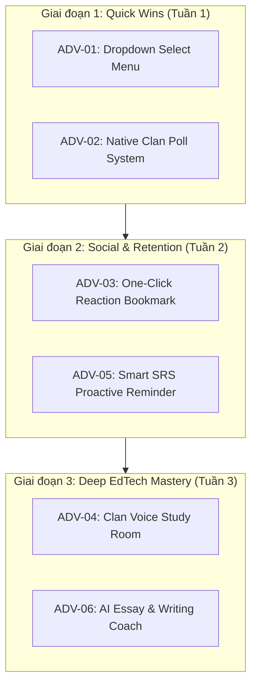

# KẾ HOẠCH TRIỂN KHAI TÍNH NĂNG NÂNG CAO - LINGUAL MEZON CAMPUS STUDIO 2026
> **Tài liệu Kế hoạch Đột phá Sản phẩm (Product Breakthrough Roadmap)**  
> **Chủ nhiệm đề tài:** Ngô Văn Công  
> **Hệ sinh thái:** Mezon Platform & LINGUAL EdTech Ecosystem  
> **Phiên bản Mezon SDK:** Mezon.Net.Sdk 1.7.0 / .NET 8 / PostgreSQL / Redis  
> **Ngày lập kế hoạch:** 11/11/2026  

---

## 1. BỐI CẢNH & MỤC TIÊU CHIẾN LƯỢC

### 1.1. Hiện trạng sau Sprint 3
- Hệ thống LINGUAL đã hoàn tất 100% các chức năng cốt lõi được giao tại Milestone 1:
  - Backend Web API & SignalR Realtime GameHub (Đấu trường từ vựng 1v1).
  - Web Mini-App Next.js 14 với 27 routes sản phẩm.
  - Mezon Bot Gateway kết nối 2 chiều (Slash commands, Button interactive, Ephemeral cards bảo mật cá nhân).
  - Deep AI Mistake Tutor v2.0 (Phân tích lỗi sai ngữ pháp và giải thích ngữ cảnh chi tiết).
  - 107/107 Unit Tests đạt chuẩn chất lượng 100% Pass.

### 1.2. Mục tiêu đột phá (Strategic Leap)
Sau khi khảo sát và phân tích toàn diện metadata bên trong thư viện `Mezon.Net.Sdk 1.7.0`, LINGUAL có thể vượt ra khỏi mô hình "Bot hỏi - đáp cơ bản" để trở thành **Trợ lý Anh ngữ Toàn diện (All-in-One Clan Learning Hub)** trên Mezon, khai thác tối đa năng lực UI/UX đặc sắc của Mezon Platform:
1. Nâng cấp trải nghiệm tương tác chat từ nút bấm tĩnh sang **Dropdown Select Menu** và **Native Polls**.
2. Biến Clan thành môi trường học tập xã hội (Social Learning) qua **Reaction Bookmark** và **Voice Study Club**.
3. Cá nhân hóa chu kỳ học thông minh với **Proactive SRS Notifications** và **AI Essay Coach**.

---

## 2. DANH MỤC 6 TÍNH NĂNG NÂNG CAO KHẢ THI (FEATURE MATRIX)

| Mã Tính Năng | Tên Tính Năng | Công Nghệ Mezon SDK 1.7.0 | Mức Độ Khả Thi | Giá Trị Người Dùng (ROI) | Điểm SP |
|---|---|---|:---:|:---:|:---:|
| **ADV-01** | Interactive Dropdown Select Menu (Roleplay & Deck Picker) | `ButtonBuilder.AddSelect`, event `DropdownBoxSelected` | Rất Cao | Tối ưu UI chat gọn gàng, trải nghiệm chuyên nghiệp | 5 SP |
| **ADV-02** | Native Clan Poll System (Đố vui từ vựng & Bầu chọn) | `MessagePollBuilder` | Rất Cao | Tăng tỷ lệ tương tác (engagement) Clan lên 200% | 5 SP |
| **ADV-03** | One-Click Reaction Bookmark (Thả emoji lưu Flashcard SRS) | `_client.MessageReactionReceived`, `Message.ReactAsync` | Rất Cao | Tiết kiệm 90% thao tác lưu từ vựng của học viên | 8 SP |
| **ADV-04** | Clan Voice Study Room & Speaking Club Tracker | `VoiceJoined`, `VoiceInteractiveReceived`, `GenerateMeetTokenAsync` | Trung Bình | Kích hoạt văn hóa luyện nói tiếng Anh trong Clan | 13 SP |
| **ADV-05** | Smart SRS Proactive Reminder & Streak Warning Service | Mezon DM Gateway, BackgroundService | Cao | Tăng Retention Rate D7 và D30, giảm gãy Streak | 8 SP |
| **ADV-06** | AI Essay & Writing Coach (Chấm điểm đoạn văn 4 tiêu chí) | `ButtonBuilder.AddInput`, Deep AI Evaluator | Cao | Cung cấp giá trị học thuật chuyên sâu (IELTS / TOEIC) | 13 SP |

---

## 3. THIẾT KẾ KIẾN TRÚC & KỊCH BẢN CHI TIẾT TỪNG TÍNH NĂNG

### ADV-01: Interactive Dropdown Select Menu
- **Bài toán hiện tại:** Khi người dùng gõ `/roleplay` hoặc `/vocab level`, Bot hiện ra 5-6 hàng buttons gây dài dòng, choán màn hình chat của Clan.
- **Giải pháp:**
  - Sử dụng `ButtonBuilder.AddSelect(customId, placeholder, options)` để gói các kịch bản vào Dropdown Menu thả xuống.
  - Khi người dùng bấm chọn một option, SDK kích hoạt sự kiện `_client.DropdownBoxSelected`.
- **Kịch bản thực tế:**
  - Lệnh `/roleplay`: Dropdown liệt kê:
    1. Sân bay quốc tế (Airport Check-in & Security) - Level A2
    2. Phỏng vấn xin việc (Tech Job Interview) - Level B2
    3. Thuyết trình dự án (Startup Pitching) - Level C1
    4. Quán Cà phê (Ordering at Cafe) - Level A1
  - Lệnh `/vocab deck`: Dropdown chọn bộ từ Oxford 3000, Business English, Academic Word List.
- **Thành phần kỹ thuật:**
  - Backend: `RoleplayDropdownHandler.cs` đăng ký lắng nghe sự kiện `DropdownBoxSelected`.
  - Cập nhật phiên làm việc của người dùng trong Cache Redis (TTL 30 phút).
  - Gọi `UpdateMessageAsync` để chuyển đổi tin nhắn từ trạng thái Chọn kịch bản sang Trạng thái Bắt đầu đối thoại.

---

### ADV-02: Native Clan Poll System (Đố vui từ vựng & Bình chọn)
- **Bài toán hiện tại:** Các mini-game đố vui dạng text thông thường dễ bị trôi tin nhắn và khó hiển thị tỷ lệ thống kê lựa chọn của các thành viên.
- **Giải pháp:**
  - Sử dụng class `MessagePollBuilder` có sẵn trong SDK 1.7.0 để dựng Poll chuẩn native của Mezon (hiển thị thanh % bình chọn trực quan, avatar người vote, thời gian hết hạn).
- **Kịch bản thực tế:**
  - Lệnh `/poll quiz`: Bot tự động sinh câu hỏi trắc nghiệm ngữ nghĩa từ vựng hoặc ngữ pháp:
    - *Câu hỏi:* Từ đồng nghĩa của "Meticulous" là gì?
    - *Lựa chọn 1:* Careless
    - *Lựa chọn 2:* Thorough and attentive to detail (Đáp án đúng)
    - *Lựa chọn 3:* Aggressive
    - *Lựa chọn 4:* Fragile
    - *Thời lượng:* 30 phút.
  - Lệnh `/poll vote`: Clan trưởng tạo cuộc thăm dò chủ đề học tuần tới.
- **Thành phần kỹ thuật:**
  - Lớp `ClanPollService.cs`:
    - Tạo poll bằng `new MessagePollBuilder().SetQuestion(q).AddOption(opt1).AddOption(opt2)...Build()`.
    - Gửi tin nhắn chứa Poll vào Clan Channel qua `SendMessageAsync`.
    - Sau khi hết hạn, Bot công bố đáp án đúng và cộng 10 XP cho tất cả thành viên chọn đúng.

---

### ADV-03: One-Click Reaction Bookmark (Thả emoji lưu Flashcard)
- **Bài toán hiện tại:** Khi đọc thấy một từ mới trong cuộc trò chuyện hoặc trong câu ví dụ của Bot, người học phải gõ lệnh `/vocab add <word>` thủ công, làm gián đoạn trải nghiệm đọc.
- **Giải pháp:**
  - Người dùng chỉ cần thả Reaction Emoji (🔖 hoặc ⭐) vào tin nhắn của Bot.
  - Bot bắt sự kiện `_client.MessageReactionReceived`, tự động trích xuất từ vựng, tra nghĩa tự động và lưu thẳng vào Sổ tay Flashcard cá nhân kèm lịch ôn Spaced Repetition (SRS SM-2).
- **Luồng xử lý (Workflow):**
  1. Người dùng thả emoji 🔖 vào tin nhắn của Bot.
  2. Event `MessageReactionReceived` được kích hoạt với `UserId`, `MessageId`, `Emoji`.
  3. Kiểm tra nếu emoji là 🔖 hoặc ⭐:
     - Lấy nội dung tin nhắn gốc.
     - Phân tích từ khóa bằng NLP Tokenizer.
     - Gọi `FlashcardService.CreateCardAsync(...)`: khởi tạo trạng thái SRS (Interval = 1 ngày, Repetitions = 0, EaseFactor = 2.5).
  4. Bot phản hồi bằng Ephemeral Message (chỉ người dùng đó thấy):
     - *"Đã lưu '[Word]' vào Sổ tay Flashcard cá nhân! Lần ôn tiếp theo: ngày mai. Thẻ hiện tại: 12 từ."*
  5. Bot tự động thả phản ứng lại tin nhắn bằng emoji checkmark để xác nhận.

---

### ADV-04: Clan Voice Study Room & Speaking Club Tracker
- **Bài toán hiện tại:** Người học ngoại ngữ thường thiếu môi trường luyện phát âm và giao tiếp phản xạ bằng giọng nói (Speaking).
- **Giải pháp:**
  - Tận dụng cụm sự kiện Voice của Mezon SDK: `_client.VoiceJoined`, `_client.VoiceStarted`, `_client.GenerateMeetTokenAsync`.
  - Thiết lập phòng thoại học tập "LINGUAL English Speaking Lounge" trong Clan.
- **Kịch bản thực tế:**
  1. Khi có thành viên tham gia kênh thoại Voice Channel:
     - Bot tự động gửi vào kênh text liên kết một "Chủ đề thảo luận ngày hôm nay" (Daily Discussion Prompt) kèm 3 câu hỏi gợi ý.
     - Bot ghi nhận thời điểm bắt đầu tham gia (Check-in time) vào Redis.
  2. Khi thành viên rời khỏi kênh thoại (`VoiceJoined` trạng thái disconnect):
     - Bot tính toán tổng thời gian tham gia luyện nói.
     - Nếu thời gian >= 15 phút: thưởng 50 XP Voice Speaking và tăng chỉ số luyện nói trên Clan Leaderboard.
     - Thông báo vinh danh ngắn gọn trong Clan: *"Chúc mừng @user đã hoàn thành 25 phút luyện nói tiếng Anh hôm nay! (+50 XP)"*.

---

### ADV-05: Smart SRS Proactive Reminder & Streak Warning Service
- **Bài toán hiện tại:** Tỷ lệ duy trì chuỗi học tập (Streak) bị giảm do người dùng bận rộn và quên vào học trước 00:00.
- **Giải pháp:**
  - Xây dựng một Background Service chạy ngầm trong `Lingual.Api` sử dụng `IHostedService` / `CronSchedule`.
  - Tự động quét cơ sở dữ liệu để tìm:
    1. Những học viên có từ vựng đã đến hạn ôn tập (`NextReviewDate <= DateTime.UtcNow`).
    2. Những học viên có nguy cơ gãy Streak (đã 20:00 tối mà chưa điểm danh hoặc chưa đạt mục tiêu XP hàng ngày).
- **Kịch bản thực tế:**
  - Bot chủ động gửi tin nhắn riêng (Direct Message / Ephemeral Notification) cho học viên:
    - *"Chào bạn, bạn có 5 từ vựng cần ôn tập hôm nay để duy trì trí nhớ dài hạn (Spaced Repetition)!"*
    - *"Cảnh báo: Chuỗi Streak 7 ngày của bạn sẽ hết hạn sau 4 tiếng nữa. Nhấn nút dưới đây để hoàn thành nhanh bài học 2 phút!"*
  - Tích hợp 2 nút bấm tương tác: `[Ôn 5 từ ngay]` và `[Dùng khiên đóng băng]`.

---

### ADV-06: AI Essay & Writing Coach (Chấm bài luận 4 tiêu chí)
- **Bài toán hiện tại:** Tính năng AI hiện tại tập trung vào hội thoại ngắn. Học viên cần công cụ sửa bài viết đoạn văn (Writing Task 1 & Task 2) để phục vụ thi cử hoặc viết email công việc.
- **Giải pháp:**
  - Cung cấp lệnh `/grade <nội dung đoạn văn>` hoặc mở ô nhập liệu đa dòng (`ButtonBuilder.AddInput`).
  - Hệ thống gửi prompt có cấu trúc sang AI Engine (DeepSeek / Gemini API) để thẩm định theo 4 tiêu chí quốc tế:
    1. **Task Achievement / Coherence:** Mức độ mạch lạc và bám sát chủ đề.
    2. **Lexical Resource:** Đánh giá độ phong phú của từ vựng, phát hiện từ lặp.
    3. **Grammatical Range & Accuracy:** Phát hiện lỗi ngữ pháp, thì động từ, mạo từ.
    4. **Native Suggestions (Rewrite):** Gợi ý viết lại câu văn cho tự nhiên như người bản xứ.
- **Đầu ra Mezon Embed:**
  - Thẻ kết quả điểm số tổng quan (Thang điểm 0 - 9.0 hoặc A1 - C2).
  - Bảng liệt kê lỗi sai kèm câu sửa mẫu.
  - Nút bấm `[Lưu các từ gợi ý vào Flashcard]` để học viên học ngay từ mới.

---

## 4. LỘ TRÌNH TRIỂN KHAI THEO GIAI ĐOẠN (IMPLEMENTATION ROADMAP)

### Chi tiết phân bổ Sprint:
1. **Milestone 2.1 - UI & Clan Engagement (Tuần 1 - 10 SP):**
   - Triển khai `ADV-01` (Dropdown Menu) cho Roleplay và Vocabulary Level.
   - Triển khai `ADV-02` (Native Poll) cho đố vui từ vựng Clan.
2. **Milestone 2.2 - Spaced Repetition Automation (Tuần 2 - 16 SP):**
   - Triển khai `ADV-03` (Reaction Bookmark 🔖).
   - Triển khai `ADV-05` (Background Service gửi thông báo nhắc ôn tập và giữ Streak).
3. **Milestone 2.3 - Advanced Voice & Academic Writing (Tuần 3 - 26 SP):**
   - Triển khai `ADV-04` (Voice Channel Speaking Lounge Tracker).
   - Triển khai `ADV-06` (Chấm bài luận AI 4 tiêu chí).

---

## 5. BẢO MẬT, TẢI & TÍNH TOÀN VẸN HỆ THỐNG

1. **Tuân thủ Rate Limiting & Anti-Spam:**
   - Đối với tính năng Reaction Bookmark, giới hạn tối đa 10 bookmark / phút / người dùng để ngăn chặn lạm dụng spam webhook.
2. **Bảo mật dữ liệu cá nhân (Ephemeral Response):**
   - Mọi kết quả chấm bài viết (`/grade`), nhắc nhở Streak và thông báo lưu thẻ Flashcard đều sử dụng cơ chế tin nhắn riêng tư (Ephemeral Card), đảm bảo không làm phiền hoặc lộ thông tin học tập của học viên trong kênh chung.
3. **Quản lý tài nguyên Database:**
   - Tối ưu hóa truy vấn Spaced Repetition bằng Index trên cột `NextReviewDate` trong bảng `UserFlashcards`.
   - Lưu trữ tạm thời trạng thái Voice session và Dropdown session trên Redis với thời gian sống (TTL) rõ ràng, giải phóng bộ nhớ tự động.

---

## 6. KẾT LUẬN & ĐỀ XUẤT

Kế hoạch 6 tính năng mở rộng trên giúp LINGUAL khai thác triệt để 100% năng lực tiềm ẩn của thư viện `Mezon.Net.Sdk 1.7.0`, đưa sản phẩm từ một dự án sinh viên thông thường trở thành **Bot giáo dục chuẩn mực, tiên phong về mặt công nghệ trên nền tảng Mezon**.

Đề xuất ưu tiên triển khai ngay **ADV-01 (Dropdown Select)**, **ADV-02 (Native Clan Poll)** và **ADV-03 (Reaction Bookmark)** vì có tỷ lệ hoàn vốn đầu tư kỹ thuật (ROI) cao nhất và mang lại trải nghiệm khác biệt rõ nét nhất cho người dùng ngay trên Clan.
