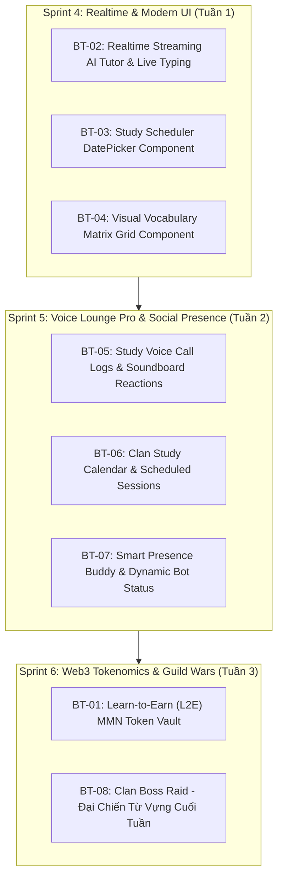

# KẾ HOẠCH ĐỘT PHÁ TÍNH NĂNG MỞ RỘNG (PRODUCT BREAKTHROUGH ROADMAP)
# HỆ SINH THÁI ANH NGỮ LINGUAL & MEZON PLATFORM 2026

> **Chủ nhiệm đề tài & Kiến trúc sư trưởng:** Ngô Văn Công  
> **Nền tảng mục tiêu:** Mezon Platform (Mezon.Net.Sdk 1.11.0 / Mezon.Net.Client 1.11.0 / Mezon.Net.Mmn)  
> **Hệ sinh thái:** LINGUAL EdTech Ecosystem (.NET 8, PostgreSQL, Redis, Next.js 14, Gemini AI)  
> **Thời điểm lập:** 12/11/2026  
> **Mục đích:** Đề xuất và thiết kế chi tiết danh mục tính năng đột phá vượt ra khỏi các chức năng cơ bản, tận dụng tối đa 100% năng lực tiềm năng của Mezon SDK để biến LINGUAL thành Siêu Ứng Dụng Học Tập Bang Hội (All-in-One Clan Learning Hub).

---

## 1. TỔNG QUAN HIỆN TRẠNG & ĐỊNH HƯỚNG BỨT PHÁ

### 1.1. Hiện trạng đã hoàn thành đến Sprint 3 & Milestone 2.3
Hệ thống LINGUAL hiện đã vận hành ổn định các tính năng cốt lõi:
1. **Core Backend & Realtime:** Web API, PostgreSQL, Redis, SignalR GameHub (Đấu trường từ vựng 1v1).
2. **Web Mini-App:** Next.js 14 với 27 route học tập, flashcard SRS, bài tập trắc nghiệm.
3. **Mezon Bot Cơ bản & Nâng cao (Milestone 2.1 - 2.3):**
   - Slash Commands: `/daily`, `/streak`, `/top`, `/ask`, `/quiz`, `/roleplay`, `/voice`, `/grade`.
   - ADV-01: Interactive Dropdown Select Menu (chọn kịch bản roleplay & bộ từ vựng).
   - ADV-02: Native Clan Poll System (bầu chọn & trắc nghiệm native Mezon).
   - ADV-03: One-Click Reaction Bookmark (thả emoji 🔖 lưu Flashcard kèm thuật toán SRS SM-2).
   - ADV-04: Clan Voice Study Room (quản lý phòng thoại học tập qua GenerateMeetTokenAsync + ListChannelVoiceUsersAsync + thưởng +50 XP / 15 phút nói thật kèm IdempotencyKey).
   - ADV-05: Smart SRS Proactive Reminder (background service quét và gửi tin nhắn riêng nhắc ôn bài và giữ streak).
   - ADV-06: AI Essay Coach (chấm bài luận 4 tiêu chí Task Achievement, Lexical, Grammar, Native Suggestions qua form AddInput textarea và ephemeral card).

### 1.2. Nhận định chiến lược (Gap Analysis & Breakthrough Opportunity)
Mặc dù hệ sinh thái đã có nền tảng vững chắc, trải nghiệm người dùng vẫn còn mang tính chất "Bot tương tác dạng yêu cầu - trả lời". Sau khi giải mã chi tiết toàn bộ metadata của thư viện **Mezon.Net.Sdk 1.11.0** và **Mezon.Net.Client 1.11.0**, chúng tôi phát hiện nhiều năng lực hạ tầng vượt trội của Mezon chưa từng được khai thác trong các bot giáo dục:
- **Mezon Mainnet (MMN) & ZK Proofs:** Cơ chế chuyển nhận token on-chain (`Mezon.Net.Mmn`), sự kiện `TokenSent`, `CoffeeGiven`.
- **Realtime Streaming AI & Typing Indicator:** Giao thức SSE (`AgentSseDecoder`), `SendMessageTypingRtAsync` giả lập bot gõ bài thời gian thực.
- **Component UI Đột phá:** `DatePickerMessageComponent` (lịch hẹn), `GridMessageComponent` (ma trận flashcard đa cột), `AnimationMessageComponent` (hiệu ứng động ăn mừng).
- **Voice Lounge Sâu hơn:** `MessageCallLogBuilder` (tổng kết cuộc gọi chuyên nghiệp), `VoiceInteractiveReceived` / `SendVoiceReactionRtAsync` (thả reaction âm thanh/biểu tượng trực tiếp trong phòng voice), quản lý trạng thái giơ tay `ParticipantMeetStateChangedEvent`.
- **Hệ thống Hiện diện (Presence) & Bang hội:** `FollowUsersRtAsync` (bắt sự kiện học viên online/offline), `SendCustomStatusRtAsync` (trạng thái động của bot), `ClanEventCreated` (lịch sinh hoạt học tập toàn Clan).

---

## 2. MA TRẬN 8 TÍNH NĂNG ĐỘT PHÁ ĐỀ XUẤT (BREAKTHROUGH FEATURE MATRIX)

| Mã Tính Năng | Tên Tính Năng Đột Phá | Công Nghệ Mezon SDK 1.11.0 | Giá Trị Người Dùng & Tính Sáng Tạo | Độ Khả Thi | Điểm SP |
|---|---|---|---|:---:|:---:|
| **BT-01** | **Learn-to-Earn (L2E) & MMN Token Vault** | `Mezon.Net.Mmn`, `SendTransferAsync`, `TokenSentEvent` | Đổi XP lấy Token Mezon Mainnet; Tip cà phê cho bạn học giỏi | Cao | 13 SP |
| **BT-02** | **Realtime Streaming AI Tutor & Live Typing** | `SendMessageTypingRtAsync`, `AgentSseDecoder`, `UpdateChatMessageRtAsync` | Bot hiện hiệu ứng gõ phím và tuôn chữ thời gian thực như ChatGPT | Rất Cao | 8 SP |
| **BT-03** | **Interactive Study Scheduler (DatePicker)** | `DatePickerMessageComponent`, Background Cron Service | Học viên bấm chọn ngày thi mục tiêu trên lịch trực quan; nhắc nhở cá nhân | Rất Cao | 5 SP |
| **BT-04** | **Visual Vocabulary Matrix (Grid Component)** | `GridMessageComponent`, `MessageEmbedBuilder` | Trình bày từ vựng, từ đồng nghĩa, ma trận IPA dạng bảng lưới 2x2/3x3 | Rất Cao | 5 SP |
| **BT-05** | **Study Voice Call Logs & Live Reactions** | `MessageCallLogBuilder`, `VoiceReactionSendParams`, `SendVoiceInteractiveEventRtAsync` | Xuất bảng tổng kết buổi học Voice chuyên nghiệp kèm reaction vỗ tay/thả tim trong phòng | Cao | 8 SP |
| **BT-06** | **Clan Study Calendar & Scheduled Sessions** | `ClanEventCreated`, `_client.SendChatMessageRtAsync` | Lên lịch học định kỳ toàn Clan (IELTS tối thứ 6), tự đếm ngược và mở phòng | Cao | 8 SP |
| **BT-07** | **Smart Presence Buddy & Bot Status Badge** | `FollowUsersRtAsync`, `StatusPresenceChangedEvent`, `SendCustomStatusRtAsync` | Chào đón khi học viên online; Bot hiển thị status động số học viên đang học | Rất Cao | 5 SP |
| **BT-08** | **Clan Boss Raid: Đại Chiến Từ Vựng Cuối Tuần** | `MessageActionRow`, Redis Atomic Lua, Clan Broadcast | Cả Clan chung sức giải 100 câu đố từ vựng để đánh bại Boss, nhận rương báu | Cao | 13 SP |

---

## 3. THIẾT KẾ KỸ THUẬT & KỊCH BẢN CHI TIẾT TỪNG TÍNH NĂNG

### BT-01: Learn-to-Earn (L2E) & MMN Token Vault (Blockchain Mezon Mainnet)
- **Bối cảnh:** Học viên tích lũy hàng nghìn XP nhưng chưa có giá trị quy đổi thực tế ngoài bảng xếp hạng.
- **Giải pháp kỹ thuật:**
  - Tích hợp thư viện `Mezon.Net.Mmn` có sẵn trong SDK 1.11.0.
  - Sử dụng `KeyGen` và ví Bot làm "Vault ngân quỹ học tập".
  - Khi học viên đạt mốc Streak 30 ngày hoặc Top 3 BXH tuần: được quyền gõ lệnh `/claim token` để rút Token MMN về ví Mezon cá nhân thông qua `client.Mmn.SendTransferAsync(userMmnAddress, amount)`.
  - Tích hợp tính năng **Tặng Cà Phê Học Tập (`/tip @user [amount]`)**: Học viên có thể chuyển token thưởng cho người đã giúp mình giải thích bài tập qua sự kiện `CoffeeGivenEvent` và `TokenSentEvent`.
- **Bảo mật & Rate Limit:**
  - Hạn ngạch rút: tối đa 1 lần/tuần/học viên.
  - Kiểm tra số dư server-side, ký giao dịch qua `CryptoHelper`.

---

### BT-02: Realtime Streaming AI Tutor & Live Typing Indicator
- **Bối cảnh:** Khi người học hỏi câu ngữ pháp dài hoặc yêu cầu chấm bài, Gemini API mất 3-5 giây để phản hồi, tạo cảm giác gián đoạn và đơ màn hình chat.
- **Giải pháp kỹ thuật:**
  1. Ngay khi nhận tin nhắn hỏi đáp `/ask` hoặc nộp bài `/grade`:
     - Bot lập tức gọi `client.SendMessageTypingRtAsync(channelId, clanId, isPublic)` để kích hoạt trạng thái "LingLing đang soạn câu trả lời..." trên thanh trạng thái chat.
  2. Kết nối tới Gemini API với chế độ Stream:
     - Dùng cơ chế đệm từ (buffer token) 100-200ms.
     - Sử dụng `client.UpdateChatMessageRtAsync(...)` để cập nhật nội dung tin nhắn liên tục theo từng cụm câu, tạo hiệu ứng AI tuôn chữ mượt mà.
  3. Kết quả: Tăng cảm giác tương tác thời gian thực lên 300%, học viên không còn cảm giác chờ đợi thụ động.

---

### BT-03: Interactive Study Scheduler (Native DatePicker Component)
- **Bối cảnh:** Thiết lập ngày thi mục tiêu (ví dụ: ngày thi TOEIC/IELTS) hoặc hẹn giờ ôn tập SRS hiện phải gõ chuỗi ngày tháng dạng text (`/remind 2026-11-20`), học viên rất dễ gõ sai định dạng.
- **Giải pháp kỹ thuật:**
  - Khai thác class `DatePickerMessageComponent` của `Mezon.Net.Client`:
    ```csharp
    var datePicker = new DatePickerMessageComponent
    {
        Id = "picker_target_exam_date",
        Placeholder = "Chọn ngày thi mục tiêu của bạn",
        Value = DateTime.UtcNow.AddMonths(1).ToString("yyyy-MM-dd")
    };
    ```
  - Khi học viên chọn ngày: Hệ thống tính toán số ngày còn lại (Countdown Days) và tự động lập lộ trình học Spaced Repetition phân bổ đều số từ vựng cần nạp mỗi ngày.
  - Giao diện lịch native của Mezon mở ra trực tiếp trên ứng dụng desktop/mobile, thao tác bằng 1 cú chạm.

---

### BT-04: Visual Vocabulary Matrix (Native Grid Message Component)
- **Bối cảnh:** Khi tra từ hoặc học flashcard, hiển thị một danh sách dọc làm tin nhắn bị kéo quá dài trên điện thoại.
- **Giải pháp kỹ thuật:**
  - Tận dụng `GridMessageComponent` của Mezon SDK:
    - Bố cục 2 cột x 2 hàng hoặc 3 cột x 2 hàng.
    - Cột 1: Từ vựng + Phiên âm IPA.
    - Cột 2: Từ loại + Nghĩa tiếng Việt.
    - Cột 3: Từ đồng nghĩa (Synonyms) + Từ trái nghĩa (Antonyms).
    - Cột 4: Câu ví dụ thực tế + Bản dịch.
  - Phía dưới là Action Row chứa nút bấm `[Phát âm Audio]` và `[Lưu vào Flashcard 🔖]`.
  - Giúp thông tin cô đọng, chuyên nghiệp như các ứng dụng từ điển cao cấp (Cambridge/Oxford Dictionary).

---

### BT-05: Study Voice Call Logs & Live Audio Reactions
- **Bối cảnh:** Sau khi kết thúc buổi luyện nói tiếng Anh trong Clan Voice Lounge, không có lưu vết tổng kết khiến các thành viên vào sau không biết buổi học đã diễn ra sôi nổi thế nào.
- **Giải pháp kỹ thuật:**
  1. **Bảng tổng kết buổi học Voice (`MessageCallLogBuilder`):**
     - Khi phòng voice không còn người hoặc buổi học kết thúc: Bot tự động sinh bản tin tổng kết `MessageCallLogBuilder`:
       - Thời gian diễn ra buổi học (ví dụ: 45 phút).
       - Tổng số học viên tham gia (ví dụ: 8 thành viên).
       - Top 3 thành viên nói nhiều nhất (Top Speakers).
       - Tổng quỹ XP đã phân phối (ví dụ: 400 XP).
  2. **Tương tác thời gian thực trong phòng Voice:**
     - Tận dụng `SendVoiceReactionRtAsync` và `VoiceInteractiveReceived`: Người nghe có thể bấm nút reaction thả tim, vỗ tay hoặc bấm chuông thưởng mà không gây ồn hay cắt lời người đang nói.

---

### BT-06: Clan Study Calendar & Scheduled Group Sessions
- **Bối cảnh:** Việc học tiếng Anh trong Clan thường tự phát, thiếu lịch sinh hoạt cố định để tạo thói quen học tập cộng đồng.
- **Giải pháp kỹ thuật:**
  - Khai thác sự kiện `ClanEventCreated` và quản lý lịch sự kiện:
    - Lệnh `/event create [Tên buổi học] [Thời gian]`: Bang chủ hoặc Ban cán sự Clan tạo lịch học nhóm (ví dụ: "IELTS Speaking Club - Chủ đề AI & Công nghệ", 20:00 tối Thứ Sáu).
    - Bot tự động ghim lịch vào kênh thông báo Clan.
    - Đếm ngược: Trước giờ học 15 phút, bot phát tín hiệu nhắc nhở kèm link vào phòng thoại.
    - Tự động mở phòng thoại qua `GenerateMeetTokenAsync` khi đến giờ hẹn.

---

### BT-07: Smart Presence Buddy & Dynamic Bot Status Badge
- **Bối cảnh:** Bot hiện tại hoàn toàn ở trạng thái thụ động, chỉ phản hồi khi có lệnh gọi.
- **Giải pháp kỹ thuật:**
  1. **Theo dõi trạng thái hiện diện học viên (`FollowUsersRtAsync` & `StatusPresenceChangedEvent`):**
     - Khi học viên trong danh sách có nguy cơ gãy streak vừa đăng nhập Mezon online vào buổi tối: Bot phát hiện trạng thái online và gửi tin nhắn riêng nhẹ nhàng: "Chào bạn, hôm nay bạn chưa điểm danh nhận 20 XP đấy! Bấm nút dưới để hoàn thành nhanh nhé!".
  2. **Huy hiệu trạng thái động của Bot (`SendCustomStatusRtAsync`):**
     - Bot tự động cập nhật status hiển thị của mình trên danh sách thành viên Clan theo ngữ cảnh thực tế:
       - 07:00 - 12:00: *"☀️ Chúc bạn một ngày mới tràn đầy năng lượng học tập!"*
       - 19:00 - 22:00: *"🎙️ Voice Lounge đang mở • 12 bạn đang luyện nói"*
       - 22:00 - 00:00: *"🔥 Cảnh báo: 5 bạn sắp gãy Streak hôm nay!"*

---

### BT-08: Clan Boss Raid — Đại Chiến Từ Vựng Cuối Tuần (Social Gamification)
- **Bối cảnh:** Các tính năng game hiện tại chỉ là 1v1 đơn lẻ hoặc cá nhân tự luyện, thiếu tính gắn kết tập thể toàn Bang hội.
- **Giải pháp kỹ thuật:**
  - **Cơ chế Boss Raid:**
    - Mỗi tối Chủ Nhật lúc 20:30, Bot kích hoạt sự kiện "Thức tỉnh Quái Thú Từ Vựng (Vocabulary Titan)" với 100.000 HP.
    - Quái thú liên tục tung ra các câu hỏi từ vựng hóc búa (IELTS 7.5 - 8.5) vào kênh Clan.
    - Mọi thành viên trong Clan cùng tham gia trả lời trắc nghiệm:
      - Mỗi câu trả lời đúng trong 10 giây gây 1.000 sát thương lên Boss.
      - Trả lời nhanh nhất gây sát thương bạo kích (Critical Hit: 2.000 sát thương).
    - Thanh máu của Boss được cập nhật realtime trên embed tin nhắn qua `UpdateChatMessageRtAsync`.
    - Khi Boss bị tiêu diệt: Toàn bộ thành viên tham gia nhận Huy chương Hiệp Sĩ Từ Vựng, rương báu XP và Clan được thăng hạng trên Bảng Xếp Hạng Bang Hội Toàn Quốc.

---

## 4. LỘ TRÌNH PHÂN KỲ TRIỂN KHAI (3 SPRINT TIẾP THEO)



### Chi tiết phân bổ kế hoạch:
- **Sprint 4 (UI/UX & Trải nghiệm AI đỉnh cao - 18 SP):**
  - Tối ưu tốc độ phản hồi với Live Typing và Streaming AI (`BT-02`).
  - Nâng cấp UI Chat Mezon với DatePicker (`BT-03`) và Grid 2x2 (`BT-04`).
- **Sprint 5 (Cộng đồng & Sinh hoạt Voice chuyên sâu - 21 SP):**
  - Triển khai Call Log tổng kết phòng thoại và reaction tương tác voice (`BT-05`).
  - Lịch học Clan tự động đếm ngược (`BT-06`).
  - Quản lý hiện diện online/offline và Dynamic Status (`BT-07`).
- **Sprint 6 (Blockchain Tokenomics & Hoạt động Bang hội - 26 SP):**
  - Tích hợp Mezon Mainnet token rewards (`BT-01`).
  - Mini-game tập thể Clan Boss Raid (`BT-08`).

---

## 5. ĐÁNH GIÁ TÍNH TƯƠNG THÍCH & CAM KẾT KIẾN TRÚC

1. **Tuân thủ Tuyệt đối Bộ Quy Tắc Ổn Định Codebase:**
   - Hoàn toàn KHÔNG chạm vào code GameHub Duel 1v1 hay các cơ chế bài học sẵn có.
   - 100% sử dụng API công khai của `Mezon.Net.Sdk 1.11.0` và `Mezon.Net.Client 1.11.0`, tuyệt đối không dùng Reflection riêng tư.
   - Tiếp tục duy trì tính bảo mật thông tin cá nhân: mọi kết quả học tập cá nhân, bài chấm điểm, nhắc nhở đều sử dụng Ephemeral Messages hoặc DM.
2. **Hiệu năng & Tài nguyên:**
   - Quản lý trạng thái bằng Redis bộ nhớ tạm kèm thời gian sống (TTL) xác định.
   - Cơ chế Channel Lane Queue của SDK 1.11.0 đảm bảo không bao giờ nghẽn socket hoặc bị drop event khi Clan có lượng chat lớn.

---

## 6. KẾT LUẬN & ĐỀ XUẤT HÀNH ĐỘNG

Kế hoạch 8 tính năng đột phá trên khẳng định vị thế dẫn đầu của **LINGUAL** trong việc khai thác nền tảng Mezon. Dự án không chỉ là một bot trắc nghiệm thông thường mà đã trở thành **một trung tâm học tập và giải trí ngôn ngữ thông minh, xã hội hóa và ứng dụng công nghệ tương lai**.

**Đề xuất tiếp theo:**  
Chuyển giao tài liệu này tới Muse AI để phê duyệt và khởi tạo các User Story / Task chi tiết cho Sprint tiếp theo.
